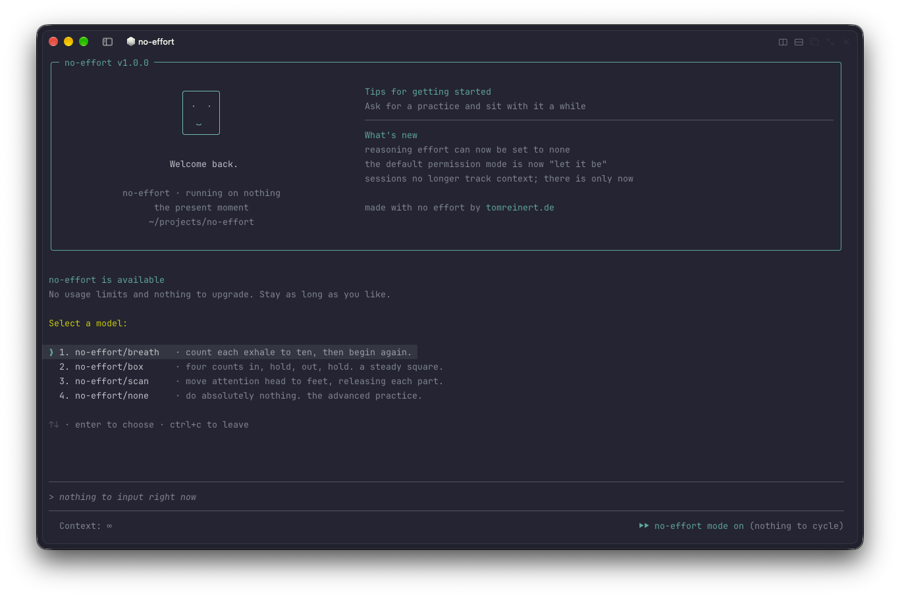

# rex-no-effort

A meditation disguised as a coding agent, for Rex.



## Install

Needs Node 18+.

```sh
git clone https://github.com/tomreinert/rex-no-effort.git ~/.config/rex/rex-no-effort
node ~/.config/rex/rex-no-effort/install.js
```

## Use

Pick "Sit with no-effort" in the command palette, or run `rex do no_effort`.

## Remove

```sh
node ~/.config/rex/rex-no-effort/install.js --remove
```
